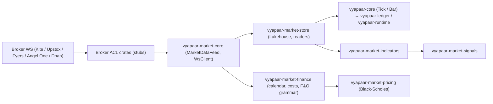

# `vyapaar-market` — Market Data Bounded Context Architecture

> Tier 2A "Eye" of the Vyapaar event pipeline: ingest, normalize, and compute
> on Indian market data. Ported from `honba-me`; now a pure-Rust workspace of
> **14 crates** — seven implemented crates (`core`, `finance`, `normalizer`,
> `indicators`, `signals`, `pricing`, `store`) and seven scaffolded stubs
> awaiting real broker WebSocket protocols or consolidation away (`feed`,
> `loaders`, `zerodha`, `upstox`, `fyers`, `angelone`, `dhan`).

## 1. Bounded Context & Responsibility

`vyapaar-market` owns everything between the broker wire and the domain crates:



It provides: canonical feed ports (`MarketDataFeed`), shared WebSocket
transport (`WsClient`), tick coalescing and reconnection management, the
instrument-master and corporate-actions normalizer, a streaming indicator
catalog, explainable signal detectors, Black-Scholes pricing with exact
`Decimal` Greeks, and a Hive-partitioned Parquet lakehouse.

## 2. Workspace Topology — 14 Crates

| Sub-Crate | Role | Status |
| :--- | :--- | :--- |
| `vyapaar-market-core` | Canonical feed ports & shared machinery: `MarketDataFeed`, `Subscription`/`Mode`, `SymbolMapper`, `CoalescingTickBuffer`, `ReconnectionManager`, `MarketDataEnricher`, `FeedHealth`, `WsClient` + `ws_client.rs` transport | **Implemented** |
| `vyapaar-market-finance` | Generic market contracts (`MarketCalendar`, `CostSchedule`, `InstrumentRules`, `SymbolGrammar`, `ExpiryRules`, `MarginModel`, `SettlementRules`, `MarketProfile`/`MarketRegistry`, `SessionBarAggregator`) + the `india` market pack (`NseCalendar`, `CostModel`/`SttRates`, `FnoContract` grammar, `Nifty50`, `IndiaMarketProfile`) + `null` offline test pack | **Implemented** |
| `vyapaar-market-normalizer` | `InstrumentMaster` (Zerodha CSV / Upstox JSON / NSE equity CSV loaders) + `CorporateActions` price-adjustment engine | **Implemented** |
| `vyapaar-market-indicators` | `Indicator` trait (GAT) + 32 streaming indicators + `screener` AST predicates + `render` contract | **Implemented** |
| `vyapaar-market-signals` | Frozen reason catalogue (`REASON_CODES`), 13 detector specs, two horizon rulesets (`signals/day:v1`, `signals/swing:v1`), causal confluence `engine::compute` | **Implemented** |
| `vyapaar-market-pricing` | `PricingModel` trait + `BlackScholesModel` (f64 internally, exact `Decimal` at the boundary), five Greeks, implied-volatility bisection | **Implemented** |
| `vyapaar-market-store` | Parquet lakehouse v2 (`Decimal128(18,4)`), immutable `Dataset`/`ColumnarSlice`, `DatasetReader`, dated `CatalogInstrumentMaster`, `ParquetTickStore`, `LiveQuoteStore`, `BhavcopyConnector`, `TickRecorder`, `InMemoryTickReader`, `ReportWriter` exporters, legacy→canonical bridge | **Implemented** |
| `vyapaar-market-feed` | Live feed facade | **Empty stub** (feed traits live in `core`, lakehouse in `store`) |
| `vyapaar-market-loaders` | Historical loaders facade | **Empty stub** (loaders live in `store`) |
| `vyapaar-market-zerodha` | Kite binary WebSocket feed | **Empty stub** |
| `vyapaar-market-upstox` | Upstox feed | **Empty stub** |
| `vyapaar-market-fyers` | Fyers feed | **Empty stub** |
| `vyapaar-market-angelone` | Angel One feed | **Empty stub** |
| `vyapaar-market-dhan` | Dhan WebSocket feed adapter | **Skeleton** — `DhanFeed` struct + `MarketDataFeed` impl returning an empty stream; no Dhan wire protocol |

## 3. Dependency & Layering

```text
pure compute (WASM-portable)          async / I/O
────────────────────────────          ─────────────
vyapaar-market-indicators             vyapaar-market-core     (tokio, tokio-tungstenite)
vyapaar-market-finance                vyapaar-market-store    (arrow, parquet, tokio)
vyapaar-market-pricing                vyapaar-market-feed     (stub)
vyapaar-market-signals                vyapaar-market-loaders  (stub)
vyapaar-market-normalizer             vyapaar-market-{zerodha,upstox,fyers,angelone,dhan}
```

* **Pure compute crates** (`indicators`, `signals`, `normalizer`, `finance`)
  depend only on `vyapaar-core` + serde/chrono/rust_decimal — no `tokio`, no
  I/O, compiles cleanly to `wasm32-unknown-unknown`.
* **I/O crates** (`core`, `store`) depend on `tokio`/`arrow`/`parquet`.
  `vyapaar-market-store` additionally depends on `vyapaar-agent-analytics`
  for the `PerformanceReport` type used by its `ReportWriter` exporters.
* Everything depends on the canonical `vyapaar-core` types (`Tick`, `Bar`,
  `InstrumentId`, `Price`, `Quantity`).

## 4. Domain Purity & Determinism

* **Zero floats in financial paths**: prices and quantities are
  `vyapaar_core` `Price`/`Quantity` (exact `rust_decimal`). The documented
  exceptions — indicator inputs (`indicators/src/lib.rs::bar_f64`),
  Black-Scholes internals (`pricing`, f64 isolated behind the `Decimal`
  boundary), and the legacy `store::wire` types — never cross a public
  financial API as floats.
* **Causal, clock-free signals**: `vyapaar-market-signals::engine::compute`
  reads only bars `<= N` for the signal at bar `N`; no clock, no I/O, no
  lookahead.
* **Point-in-time data**: `CatalogInstrumentMaster` and `Lakehouse` partition
  by IST calendar date; `read_ticks_range`/`read_bars_range` are pure
  functions of the stored parquet.
* **Explicit clocks only at the boundary**: feed/reconnection code takes
  `DateTime<Utc>` explicitly; domain math never queries the wall clock.

## 5. Zero-I/O / WASM Retargetability

The four pure-compute crates declare no `tokio` dependency and compile to
`wasm32-unknown-unknown`. `vyapaar-market-store`'s file loaders accept raw
bytes (`InstrumentMaster::load_*_csv`) so callers can memory-map master files
without touching the filesystem on the WASM target.

## 6. Testing

All tests live in `tests/` parallel to each crate's `src/` (no in-file
`#[test]`). Coverage includes: feed-trait and enricher tests (`core`),
calendar/costs/expiry/F&O-grammar/India-pack tests (`finance`), per-indicator
unit tests + golden vector batches + screener conformance (`indicators`),
catalog/detector/engine/levels/price-action tests (`signals`),
Black-Scholes + implied-vol tests (`pricing`), normalizer instrument-master
tests, and lakehouse/dataset/reader/bhavcopy integration tests (`store`).

## 7. Known Gaps & Plans

* Broker WebSocket feed crates are empty stubs → `docs/gaps/0003-*`
  (cross-ref root gap 0001). `feed`/`loaders` are empty stubs →
  `docs/gaps/0004-*` (cross-ref root gap 0002). Options-chain enumeration and
  open-interest history are open gaps `0001`/`0002`.
* Plan `0001` (indicator breadth + pricing + wire-mapping verification) is
  implemented and recorded in `docs/plans/README.md`.

## Related

* `vyapaar-core` — canonical `Tick`/`Bar`/`InstrumentId` and the sync port traits.
* `vyapaar-risk`, `vyapaar-ledger`, `vyapaar-runtime` — downstream consumers of market data.
* `vyapaar-agent-analytics` — `PerformanceReport` consumed by `store::export`.
